# CV Analyzer
### AI-Powered Resume Analysis, Skill-Gap Detection & CV Optimization

An end-to-end resume analysis and optimization application built with **Python, Flask, Machine Learning, NLP, and MySQL**.

CV Analyzer helps candidates evaluate resume content, identify missing skills for target roles, explore predicted shortlisting outcomes, optimize their resumes, and prepare for interviews through an interactive dashboard.

> **Project status:** Functional prototype. ML predictions are experimental, and some configuration, security, and evaluation improvements remain in progress.

## Features

### Resume Upload & Analysis
- Upload resumes in PDF or DOCX format.
- Extract and process resume text.
- Predict job categories from CV content.
- Classify CV lines as useful content, unnecessary content, or section headings.
- Display analysis results in an interactive dashboard.

### BERT-Based CV Quality Assessment
- Generate predicted CV quality scores using a BERT-based inference service.
- Provide score explanations and improvement insights.
- Analyze the structure and content of resumes.

### Hybrid Skill-Gap Analysis
- Identify candidate skills from resume text.
- Compare extracted skills with requirements for a target role.
- Highlight present and missing skills.
- Combine hybrid skill matching with ML-based gap analysis.
- Allow users to select or reject suggested skills.

### Resume Optimization & Export
- Generate an optimized resume using the CV optimization service.
- Incorporate skill feedback into the optimization workflow.
- Export optimized CVs as PDF, DOCX, and PNG.
- Compare original and optimized CV content and predicted scores.

**Current limitation:** The optimization implementation may also inject automatically detected or fallback skills. It should not be used to represent unverified qualifications as genuine experience.

### Shortlisting Probability Estimation
- Estimate shortlisting probability through an ML prediction service.
- Compare predictions before and after optimization.
- Support model selection through the prediction API.

These values are model-generated estimates, not verified probabilities of receiving an interview or job offer.

### Interview Preparation
- Generate role-specific interview questions.
- Export generated questions as an image.

### Market Demand Analysis
- Access role-based market-demand analysis through a dedicated service endpoint.

Market-demand results should not be treated as verified live labor-market statistics without independent validation.

---

## Application Screenshots

### 01 — Homepage & CV Upload

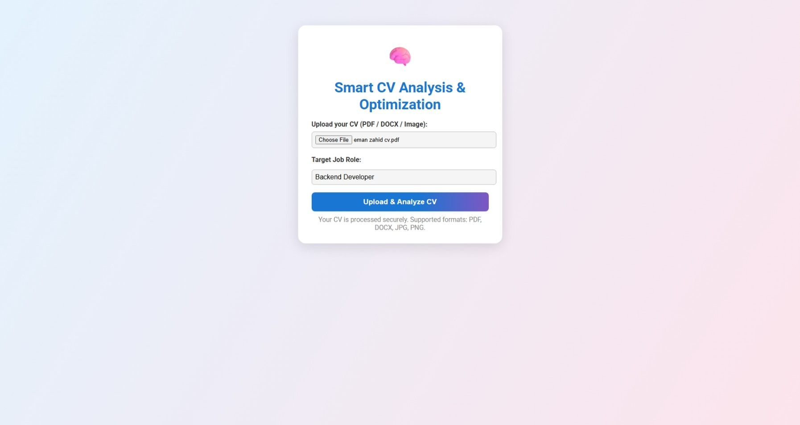

### 02 — Analysis Dashboard

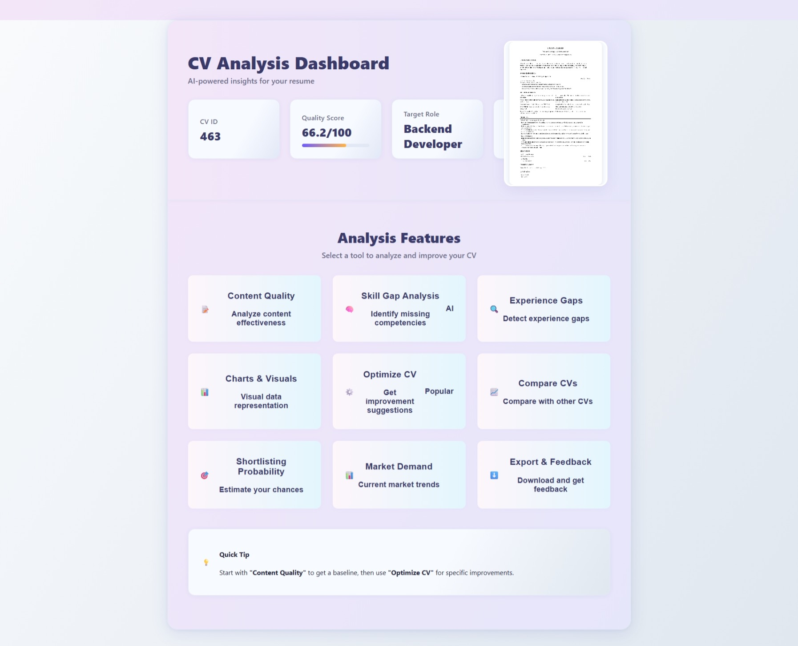

### 03 — CV Quality Score

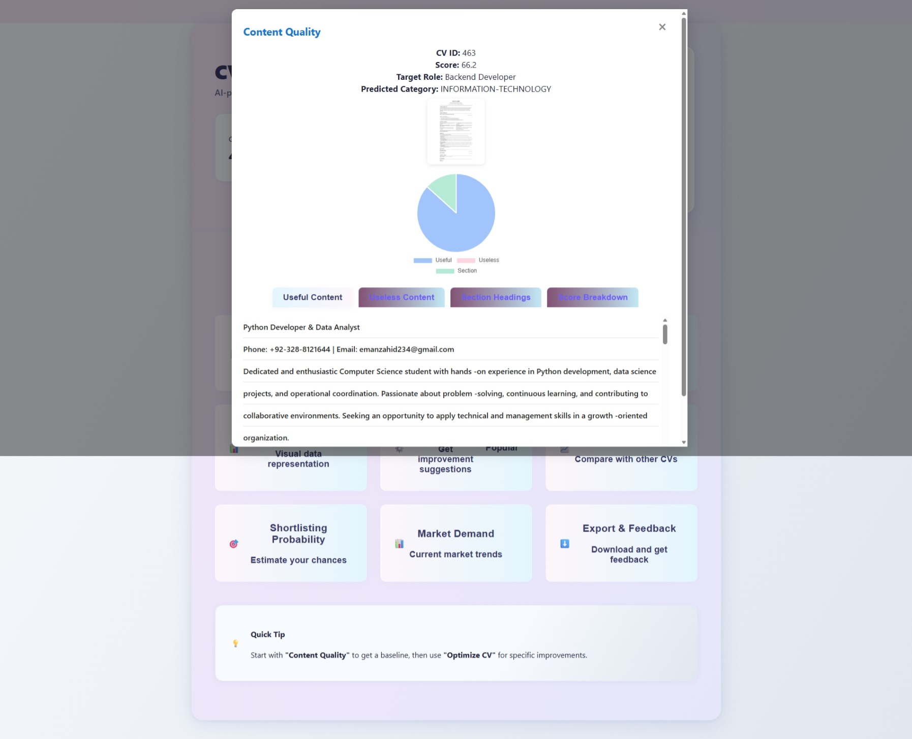

### 04 — Skill-Gap Analysis

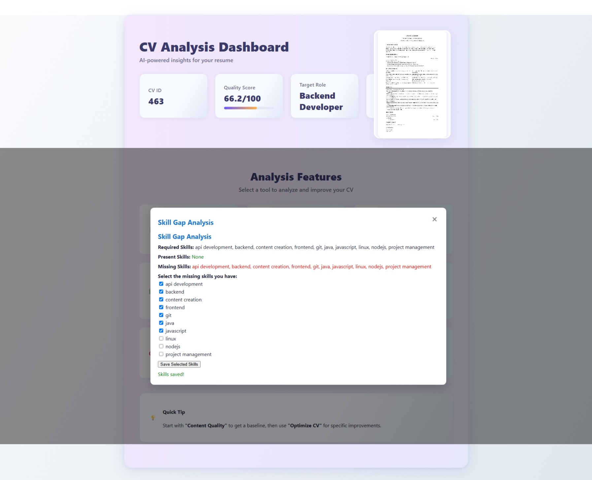

### 05 — CV Optimization

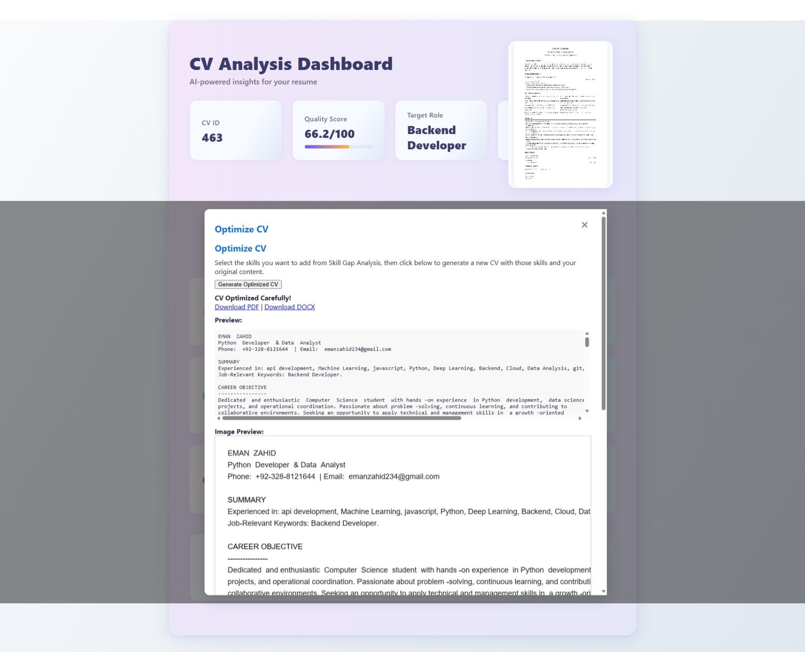

### 06 — Original vs. Optimized CV

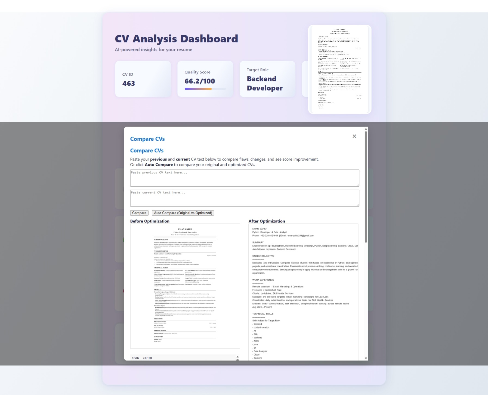

### 07 — Shortlisting Probability

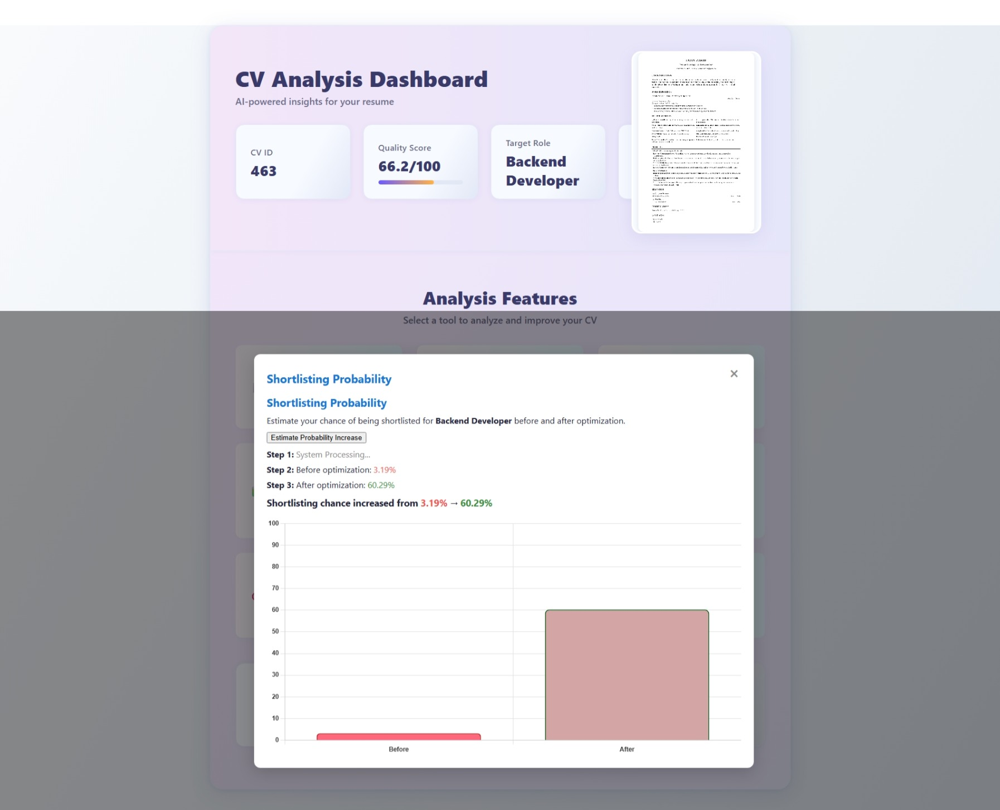

### 08 — Interview Questions

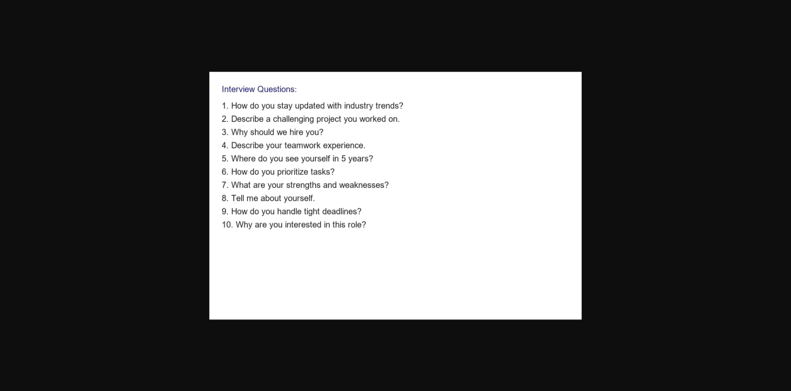

### 09 — Market Demand Analysis

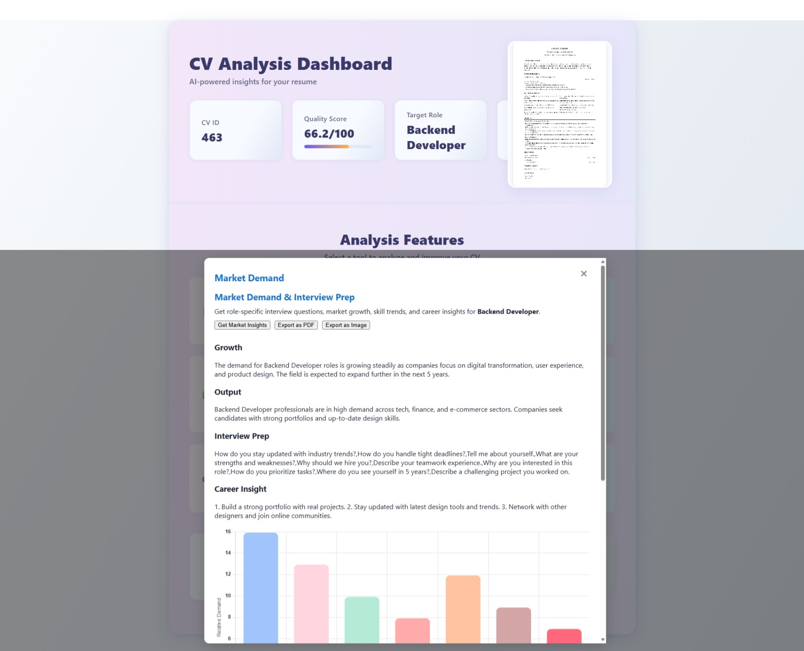

> Screenshot paths must match the actual filenames inside `docs/screenshots/`. Remove any screenshot section for which no image exists. Use redacted or synthetic resume data in public screenshots.

---

## System Architecture

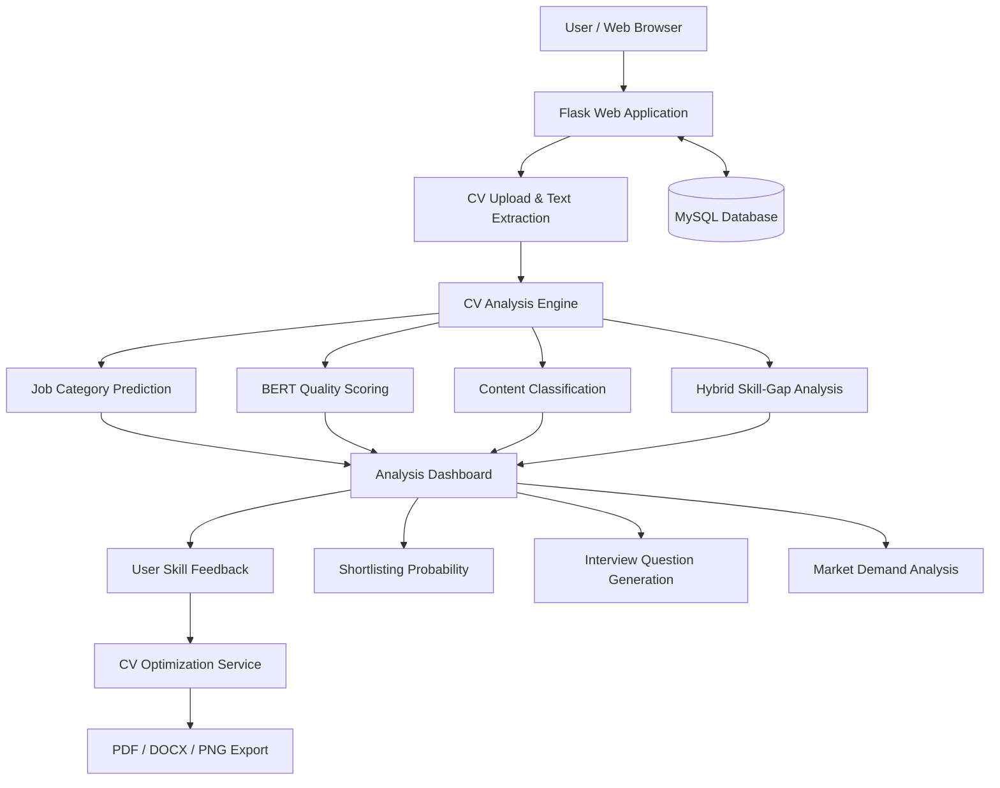

## Machine Learning & NLP Pipeline

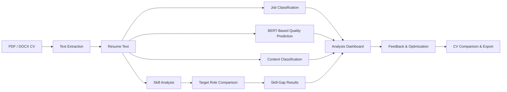

---

## Technology Stack

| Component | Technologies |
|---|---|
| Programming Language | Python |
| Backend Framework | Flask |
| Machine Learning | Scikit-learn, BERT-based prediction service |
| NLP | Sentence Transformers, NLTK |
| Database | MySQL |
| Model Serialization | Joblib |
| PDF Processing | PyPDF2, pdf2image |
| DOCX Processing | python-docx |
| Image Processing | Pillow, Matplotlib |
| Frontend | HTML, CSS, JavaScript, Jinja Templates |
| Optional AI Integration | Google Generative AI |

## Project Structure

```text
cv-analyzer/
├── app/
│   ├── db/                  # Database connection
│   ├── ml_models/           # ML-related components
│   ├── services/            # Prediction and analysis services
│   ├── static/              # Application assets
│   ├── templates/           # Flask HTML templates
│   ├── utils/               # File handling and CV rendering
│   ├── __init__.py
│   ├── __main__.py
│   └── web.py               # Main Flask application
├── cv-dashboard/            # Additional dashboard assets
├── data/                    # Data-related resources
├── docs/
│   └── screenshots/         # README screenshots
├── ml_models/               # Trained model artifacts
├── scripts/                 # Supporting scripts
├── tests/                   # Test files
├── database code.sql        # Database schema
├── requirements.txt
└── README.md
```

Generated resumes, uploaded CVs, virtual environments, caches, credentials, and other private artifacts should not be included in the public repository.

---

## Getting Started

### Prerequisites

- Python and pip
- MySQL Server
- Trained ML model artifacts required by the prediction services
- Poppler for PDF-to-image conversion
- Additional system dependencies for document conversion, where required

### 1. Clone the Repository

```bash
git clone https://github.com/EmanZahid1644/cv-analyzer.git
cd cv-analyzer
```

### 2. Create a Virtual Environment

```bash
python -m venv venv
```

On Windows CMD:

```cmd
venv\Scripts\activate
```

### 3. Install Dependencies

```bash
pip install -r requirements.txt
```

**Note:** The current dependency manifest may need updating to include all packages imported by the application, including the MySQL connector, Joblib, and document export dependencies.

### 4. Configure MySQL

Create the application database:

```sql
CREATE DATABASE cv_analysis_system;
```

Import the schema from `database code.sql`.

Update `app/db/connection.py` to use the credentials for your local MySQL installation.

For a secure setup, database credentials should be loaded from environment variables. Do not commit passwords or API keys.

### 5. Configure Trained Models

Ensure the model files referenced by the application services are available.

For example, the BERT quality prediction service loads a serialized model artifact:

```text
ml_models/bert_cv_quality_best.pkl
```

Model availability and compatibility depend on the training environment and installed library versions.

### 6. Configure Document Conversion

PDF preview generation requires Poppler.

The current implementation includes an environment-specific Poppler path in `app/web.py`. Update this configuration for your machine or refactor it to use a configurable path.

### 7. Run the Application

```bash
python -m app
```

Open the local application at:

http://127.0.0.1:5000

---

## Application Workflow

1. **Upload Resume:** The candidate uploads a PDF or DOCX file.
2. **Extract Content:** The application extracts resume text.
3. **Analyze CV:** ML and NLP services predict job category, CV quality, and content labels.
4. **Analyze Skills:** The system compares candidate skills with a selected target role.
5. **Review Feedback:** The user selects or rejects suggested skills.
6. **Optimize Resume:** The optimization service generates revised resume content.
7. **Compare Results:** The application compares original and optimized CV outputs.
8. **Export Documents:** The user can obtain PDF, DOCX, or image-based outputs.
9. **Prepare for Interviews:** Additional services generate interview questions and role-based analysis.

---

## API Endpoints

| Method | Endpoint | Description |
|---|---|---|
| GET, POST | `/` | Upload and analyze CV |
| GET | `/dashboard` | Display CV analysis dashboard |
| POST | `/optimize_cv` | Generate optimized resume |
| POST | `/get_compare_cvs` | Retrieve CV comparison |
| POST | `/compare_cv` | Compare resume text and scores |
| POST | `/submit_skill_feedback` | Save skill selections |
| POST | `/get_last_selected_skills` | Retrieve selected skills |
| POST | `/shortlist_probability` | Estimate shortlisting probability |
| POST | `/compare_shortlist_probability` | Compare shortlisting predictions |
| POST | `/interview_questions` | Generate interview questions |
| POST | `/export_interview_image` | Export questions as an image |
| POST | `/market_demand_analysis` | Generate role-based market analysis |
| POST | `/submit_export_feedback` | Submit export feedback |

## Engineering Highlights

- Integration of NLP and ML inference into a Flask application
- BERT-based resume quality prediction
- Job category classification and hybrid skill-gap analysis
- Document extraction and multi-format export
- MySQL-backed data persistence
- REST-style endpoints for analysis and comparison
- User feedback integrated into resume optimization
- Modular separation of database, services, models, templates, and utilities

---

## Known Limitations

- **Experimental ML predictions:** Scores and shortlisting estimates have not been independently validated here against real hiring outcomes.
- **Score comparison:** The current `/get_compare_cvs` implementation can artificially raise the displayed optimized score when it is lower than the original. This should be removed to preserve prediction integrity.
- **Skill accuracy:** The optimization service may introduce unverified skills from automatic analysis or fallback lists.
- **Configuration:** Some paths and database settings are environment-specific.
- **Dependencies:** The requirements file may not cover every runtime dependency.
- **Privacy:** Uploaded resumes and generated documents require appropriate access controls and retention policies.
- **Security:** Hardcoded credentials must be removed and rotated before publishing or deploying the application.

## Future Improvements

- Reproducible ML training and evaluation reports
- Model performance benchmarking and error analysis
- Evidence-based CV rewriting with user-confirmed qualifications
- Secure configuration using environment variables
- Improved file validation and data privacy controls
- Docker-based deployment
- Automated testing and CI/CD
- Cloud deployment and production-ready authentication

---

## Author

**Eman Zahid**

BS Computer Science | AI & Machine Learning | Python Backend Development

GitHub: [EmanZahid1644](https://github.com/EmanZahid1644)

---

## Disclaimer

CV Analyzer is an educational and portfolio project. Its analysis, quality scores, shortlisting predictions, and recommendations are experimental decision-support outputs and do not guarantee interview invitations or employment outcomes.
